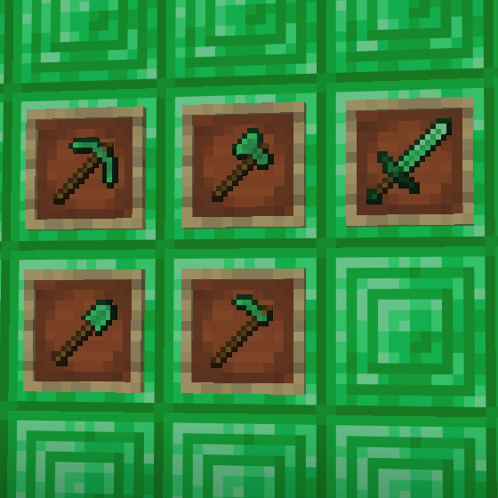

# Emerald Tools

A Fabric mod that adds tools made from emerald blocks.

## Features

Craft pickaxe, axe, shovel, hoe, and sword from emerald blocks. Emerald tools are comparable to diamond with some differences.

### Tool Stats

| Stat | Emerald | Diamond |
|------|---------|---------|
| Durability | 2031 | 1561 |
| Mining Speed | 8.0 | 8.0 |
| Attack Damage Bonus | +3.0 | +3.0 |
| Enchantability | 20 | 10 |

**Highlights:**
- Mines and hits exactly like diamond
- Netherite's durability
- Double the enchantability
- Mines anything diamond tools can mine
- Repairable with emerald blocks
- Added to the vanilla Tools and Combat creative tabs
- Crafted from emerald blocks (expensive but renewable via villager trading)
- Takes trims at the smithing table when [Smithing Templates](https://github.com/fatlard1993/smithing-templates) is installed, shown on the tool

### Emeralds in the Soil

Very occasionally the emerald hoe turns up an emerald: breaking ground on grass, dirt or a dirt path with it has a 1 in 1500 chance to pop one out, with a chime. It is one roll per swing, not per block, so a hoe that tills an area (Useful Hoe's, say) finds them no faster than one tilling a single square.

## Screenshots

## Crafting

Standard tool crafting patterns using **Emerald Blocks** and sticks.

## Pandorical

Emerald Tools goes on the server only, and **Pandorical is required there and on every player's client**: the tools are new items, and a client without Pandorical has no entry for them.

## Development

Installing is in [DEVELOPMENT.md](DEVELOPMENT.md).

## License

MIT, see [LICENSE](LICENSE).
